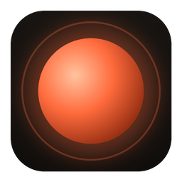

  

<h1 align="center">AICreativeStudio</h1>

  <strong>Tu estudio creativo con IA. Completo, privado y en tu propio equipo.</strong> 
  Crea, edita, restaura y diseña imágenes con palabras — sin subir nada a la nube.

  <a href="https://github.com/sorodriguezz/AICreativeStudio/releases/latest/download/AICreativeStudio-macOS-AppleSilicon.dmg"><strong>Descargar para macOS</strong></a> (Apple Silicon) ·
  <a href="https://github.com/sorodriguezz/AICreativeStudio/releases/latest/download/AICreativeStudio-Windows-x64.exe"><strong>Windows x64</strong></a> ·
  <a href="https://github.com/sorodriguezz/AICreativeStudio/releases/latest/download/AICreativeStudio-Windows-ARM64.exe"><strong>Windows ARM64</strong></a>
   <a href="https://github.com/sorodriguezz/AICreativeStudio/releases/latest">Todas las versiones</a>

---

## Una sola app para todo lo visual

Hasta ahora necesitabas una herramienta para generar, otra para editar, otra para restaurar fotos viejas,
otra para el logo de tu marca y otra para exportar todo a redes. **AICreativeStudio las reúne en un solo
lugar** y entiende lo que le pides en lenguaje natural:

> *"Cambia el fondo por una playa al atardecer"*
> *"Restaura esta foto antigua y coloréala"*
> *"Diseña un logo minimalista para una cafetería llamada Aurora"*
> *"Llévala a 4K"*

La app decide qué hacer, qué modelo usar y cómo aprovechar mejor tu hardware. Tú sólo describes el resultado.

## Lo que puedes hacer

### ✦ Crear
Paisajes, animales, wallpapers, ilustraciones, conceptos. Elige un estilo, un formato (16:9, 9:16, cuadrado…)
y genera varias variaciones a la vez. Reusa la semilla de la que más te guste y sigue iterando.

### ✦ Editar con palabras
Transforma una imagen completa, **pinta una zona** para cambiar sólo eso, **borra** cables, personas o
manchas, **cambia o quita el fondo** y **extiende el encuadre** más allá de la foto original.
Lo que no tocas queda exactamente igual, píxel por píxel.

### ✦ Mejorar
Amplía ×2 o ×4 recuperando detalle, elimina ruido y grano, devuelve nitidez a rostros borrosos y
**reilumina** una foto moviendo la luz con el dedo — con vista previa en tiempo real.

### ✦ Restaurar fotos antiguas
Rayas, polvo, manchas, grano, rostros desvaídos y colores apagados. Elige entre una restauración
**documental**, fiel al original, o una **creativa** con coloreado incluido. Antes de aplicar, revisa
qué daños detectó la app y corrígelos con el pincel.

### ✦ Brand Studio
Logos con fondo transparente, versiones vectoriales (SVG) y **kits de marca completos** en segundos:
variantes sobre claro y oscuro, monocromos, favicon, íconos de app, avatares para redes, paleta de colores
en CSS y una guía de marca lista para compartir.

### ✦ Photo Studio
Retoque de retrato con piel natural y *looks* editoriales, sesiones de fotos con la identidad de una persona
y **cambio de pose** con un editor de esqueleto. Cada resultado muestra cuánto se parece a la persona real.

### ✦ Producción en lote
Guarda tus procesos como **workflows** — *"quitar fondo → ampliar → exportar para catálogo"* — y aplícalos a
cien fotos con un clic. Exporta a Instagram, historias, LinkedIn, YouTube, presentaciones o favicon de una vez.

## Privado por diseño

- **Todo ocurre en tu equipo.** Tus imágenes nunca salen de él.
- **Internet sólo para descargar modelos**, una vez, cuando tú lo pides, y para buscar actualizaciones.
- **¿Prefieres la nube?** Si tienes ChatGPT, Gemini o Claude, puedes usar tu suscripción a través de su CLI
  oficial en lugar del motor local (*Configuración → Proveedores de IA*). Nunca con API keys, y las mismas
  reglas de contenido.
- **Sin cuentas, sin suscripciones obligatorias, sin marcas de agua.**
- **Tus originales nunca se modifican:** cada edición es una versión nueva que puedes deshacer.

## Responsable con las personas reales

Para usar la identidad de alguien la registras una vez, con sus fotos de referencia y la confirmación de que es
mayor de edad, y queda un historial de todo lo que se hizo con su imagen. El consentimiento lo gestionas tú, a tu
manera, fuera de la app. Con personas reales **nunca** se generan desnudos ni imágenes sugerentes, y nunca
contenido sexual relacionado con menores. Estas reglas no se pueden desactivar.

## Hecho para tu equipo

AICreativeStudio detecta tu hardware y se adapta: usa la GPU NVIDIA en Windows, Metal en los Mac con
Apple Silicon y la CPU donde no hay aceleración. Te recomienda qué modelos descargar según tu memoria y
tu espacio en disco, y nunca te ofrece algo que tu equipo no puede ejecutar.

| | Mac Apple Silicon | Windows x64 + NVIDIA | Windows x64 / ARM64 |
| --- | :---: | :---: | :---: |
| Crear y editar | ✓ | ✓ | ✓ (más lento) |
| Restaurar, mejorar, quitar fondos | ✓ | ✓ | ✓ |
| Brand Studio y exportación | ✓ | ✓ | ✓ |
| Photo Studio con identidad y poses | ✓ (16 GB+) | ✓ (12 GB VRAM+) | según memoria |

## Instalación

1. Descarga el instalador para tu sistema:

   | Sistema | Descarga |
   | --- | --- |
   | macOS con Apple Silicon (M1, M2, M3, M4…) | [AICreativeStudio-macOS-AppleSilicon.dmg](https://github.com/sorodriguezz/AICreativeStudio/releases/latest/download/AICreativeStudio-macOS-AppleSilicon.dmg) |
   | Windows 10/11 (Intel o AMD) | [AICreativeStudio-Windows-x64.exe](https://github.com/sorodriguezz/AICreativeStudio/releases/latest/download/AICreativeStudio-Windows-x64.exe) |
   | Windows 11 en ARM (Snapdragon) | [AICreativeStudio-Windows-ARM64.exe](https://github.com/sorodriguezz/AICreativeStudio/releases/latest/download/AICreativeStudio-Windows-ARM64.exe) |

2. Ábrelo: en el primer arranque, la app prepara su motor de IA para tu equipo (unos minutos, una sola vez).
3. Elige los paquetes de modelos que quieras usar — la app te recomienda los adecuados — o usa tu suscripción
   de ChatGPT o Gemini en *Configuración → Proveedores de IA*, y empieza a crear.

**Se actualiza sola:** cuando hay una versión nueva, la app te avisa en la barra lateral y la instala con un
clic (también desde *Configuración → Actualizaciones*). Si hay trabajos en curso, espera a que terminen.

> **Primera vez en macOS:** si el sistema dice que no puede verificar la app, ve a *Ajustes del Sistema →
> Privacidad y seguridad* y pulsa **Abrir igualmente**. En Windows, SmartScreen puede pedir *Más información →
> Ejecutar de todas formas*.

## Tecnología abierta y con licencias limpias

Construido con Tauri, React y Rust, y modelos de código abierto cuyas licencias permiten uso comercial:
Stable Diffusion XL, Real-ESRGAN, BiRefNet, LaMa, GFPGAN, SCUNet, DDColor, Depth Anything, DWPose,
IP-Adapter y ControlNet, entre otros.

---

  ¿Desarrollas? Mira la <a href="docs/DEVELOPMENT.md">guía de desarrollo</a>, la
  <a href="docs/ARCHITECTURE.md">arquitectura</a> y el <a href="docs/ROADMAP.md">roadmap</a>.

